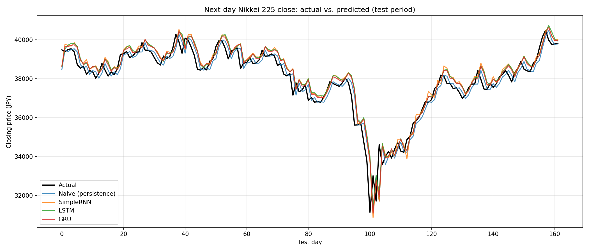
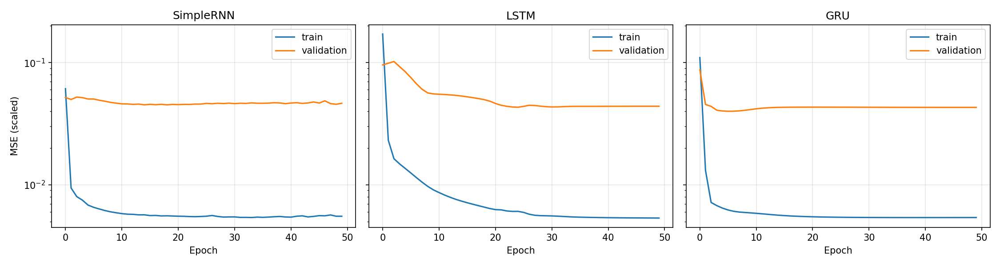

# 日経平均株価の翌日予測：SimpleRNN・LSTM・GRUの比較

過去50営業日の終値から翌営業日の日経平均株価の終値を予測し、3種類の再帰型ニューラルネットワーク（SimpleRNN・LSTM・GRU）を同一条件で比較するプロジェクトです。比較には**ナイーブ予測（ベースライン）**も加えています。

大学の講義課題として実装したコードをもとに、評価方法と構成を見直して再設計しました。

## 設計で工夫した点

| 項目 | 実装内容 | 理由 |
|---|---|---|
| **データリークの防止** | 標準化の平均・標準偏差は訓練期間のデータだけから計算します。データは時系列順に分割し、期間をまたいだシャッフルはしません。 | テスト期間を含めた統計量で標準化すると、未来の情報が学習に混入し、評価が実力以上に良く見えてしまいます。 |
| **ベースラインとの比較** | すべてのモデルを、「翌日の終値＝当日の終値」とするナイーブ予測と比較します。 | 日次の株価はランダムウォークに近く、このベースラインを上回るのは容易ではありません。上回れて初めてモデルに意味があると言えます。 |
| **公平な比較** | 層構成・ユニット数・最適化手法・乱数シードを揃え、再帰セルの種類だけを変えています。 | 結果の差をセルの違いによるものと解釈できます。 |
| **解釈しやすい評価指標** | 標準化後のMSEだけでなく、元の価格スケール（円）でRMSE・MAE・MAPEを算出します。 | 誤差の大きさを直感的に把握できます。 |
| **再現性** | 乱数シードを固定し、ハイパーパラメータを1か所にまとめ、実行時の設定を結果と一緒に保存します。 | 誰が実行しても同じ結果を得られます。 |

## ディレクトリ構成

```
.
├── main.py            # 実行の入口：読み込み → 学習 → 評価 → 保存
├── src/
│   ├── config.py      # ハイパーパラメータの一覧
│   ├── data.py        # 読み込み、スライディングウィンドウ、時系列分割、標準化
│   ├── models.py      # SimpleRNN / LSTM / GRU の構築
│   └── evaluate.py    # 評価指標、ナイーブ予測、グラフ描画
├── tests/test_data.py # ウィンドウ化・分割・標準化・評価指標の単体テスト
├── data/              # CSVをここに置く（リポジトリには含めない）
└── results/           # metrics.csv、predictions.png、learning_curves.png
```

## 実行方法

```bash
pip install -r requirements.txt
python main.py --csv data/nikkei_stock_average_daily_jp.csv
python main.py --n-steps 30 --epochs 100      # ハイパーパラメータの変更
python -m pytest                              # テストの実行
```

**データ**：[日経平均プロフィル](https://indexes.nikkei.co.jp/)からダウンロードした日経平均株価の日次データ（CSV）を使用しています。データ自体はリポジトリに含めていないため、`data/` に配置してください。

## 実験条件

| 項目 | 設定 |
|---|---|
| 入力 | 過去50営業日の終値 |
| 出力 | 翌営業日の終値 |
| データ分割 | 訓練80%・テスト20%（時系列順）。訓練データのうち直近10%を検証に使用 |
| モデル | 再帰層1層（20ユニット）＋全結合層1層 |
| 学習 | Adam（学習率0.01）、損失関数MSE、50エポック、バッチサイズ32 |

## 結果

テスト期間はデータ全体の直近20%（162営業日）です。評価指標は元の価格スケール（円）で算出しています。

| モデル | RMSE（円） | MAE（円） | MAPE (%) | RMSEのナイーブ予測比 |
|---|---|---|---|---|
| **ナイーブ予測** | **535.86** | **356.04** | **0.96** | — |
| GRU | 568.86 | 393.60 | 1.06 | +6.2% |
| LSTM | 590.79 | 414.67 | 1.12 | +10.3% |
| SimpleRNN | 608.23 | 432.80 | 1.17 | +13.5% |

**どのRNNもナイーブ予測を上回れませんでした。** RNNの中ではGRUが最も誤差が小さく、LSTM、SimpleRNNの順でした。

### テスト期間の予測結果



### 学習曲線



## 考察

**1. RNNは実質的に「前日の値をコピーする」予測を学習していた**

3つのモデルはいずれも実際の価格によく追従しています。しかし予測線はナイーブ予測とほぼ重なっており、実際の価格から1日遅れて動いています。特にテスト期間の100日目付近で価格が急落した場面では、ナイーブ予測と同様に、すべてのモデルが1日遅れで反応しました。

これはランダムウォークに近い時系列では自然な結果です。翌日の値を予測する手がかりが乏しい場合、MSEを最小化しようとすると「翌日 ≒ 当日」という予測に近づきます。実際、評価指標ではどのRNNもナイーブ予測より誤差が大きく、最も良いGRUでもRMSEが6.2%上回りました。つまり、グラフ上で価格によく追従しているように見えても、それは予測能力の証拠にはなりません。ベースラインとの比較が重要なのはこのためです。

**2. テスト期間でRNNの予測が上振れする傾向があった**

テスト期間の20〜30日目、50〜70日目、85〜95日目などで、RNNの予測が実際の価格とナイーブ予測の両方より上にずれています。原因として、テスト期間の価格が訓練データの範囲の上端付近やそれ以上にあり、モデルが外挿を求められていることが考えられます。再帰セル内部の活性化関数 `tanh` は出力が有界なため、学習範囲外の値をうまく扱えません。前日の値をほぼコピーしているにもかかわらずナイーブ予測に負けたのは、この系統的なずれが誤差に上乗せされたためだと考えられます。価格そのものではなく変化率（リターン）を予測対象にすれば、この問題は解消できると考えています。

**3. ゲート構造の違いは、最終的な誤差よりも学習の速さに表れた**

- **GRU**：最も速く収束し、約5エポックで検証損失が最小になりました。
- **LSTM**：最も収束が遅く、約25エポックまで検証損失が下がり続けました。
- **SimpleRNN**：訓練損失は速く下がりましたが、検証損失は細かく変動して不安定でした。

入力が50ステップ程度であれば、ゲート構造が解決しようとしている勾配消失の影響は小さいため、最終的な検証損失は3モデルでほぼ同じ水準になったと考えられます。テスト誤差ではGRU、LSTM、SimpleRNNの順に小さくなりましたが、その差（RMSEで最大約40円）は1回の実行によるものです。乱数シードによるばらつきを確かめるまでは、セルの優劣と結論づけることはできません。

**4. どのモデルも検証損失が訓練損失の約10倍だった**

検証データは訓練期間のうち直近10%であるため、テストデータと同様に、価格水準の変化（非定常性）による分布のずれの影響を受けます。この差は学習の初期から存在し、エポックが進んでも広がっていないため、一般的な過学習ではなく分布のずれを反映したものと考えています。

## 課題と今後の展望

- **予測対象を変化率や上昇・下落の方向にする**：「前日の値をコピーする」という安易な解が使えなくなり、外挿の問題も解消されるため、ベースラインとの比較がより意味のあるものになります。
- **ウォークフォワード検証**：今回は1回の訓練・テスト分割による評価です。評価期間をずらしながら繰り返し評価すれば、結果が時期によらず安定しているかを確認できます。
- **複数シードでの評価**：モデル間の差が小さいため、複数の乱数シードで実行し、平均と標準偏差で比較すべきです。
- **入力特徴量の追加**：出来高、他の指数（S&P 500、ドル円など）、曜日などのカレンダー情報には、過去の終値だけでは得られない情報が含まれている可能性があります。
